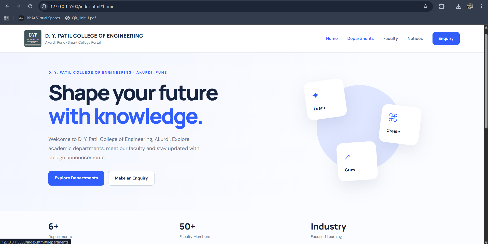
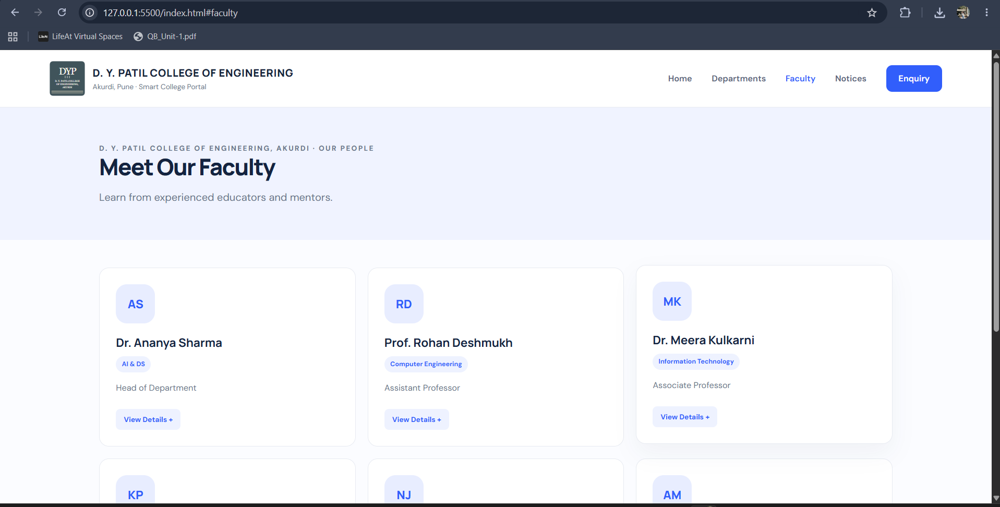
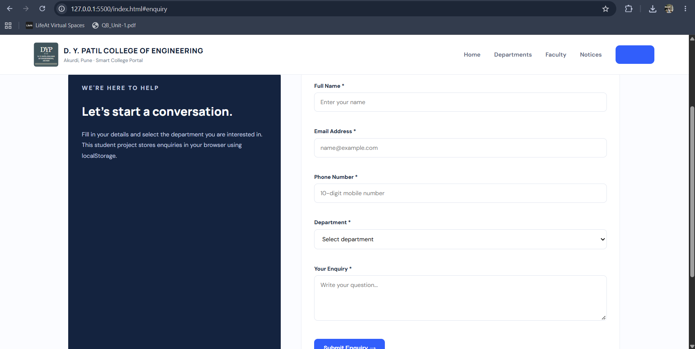
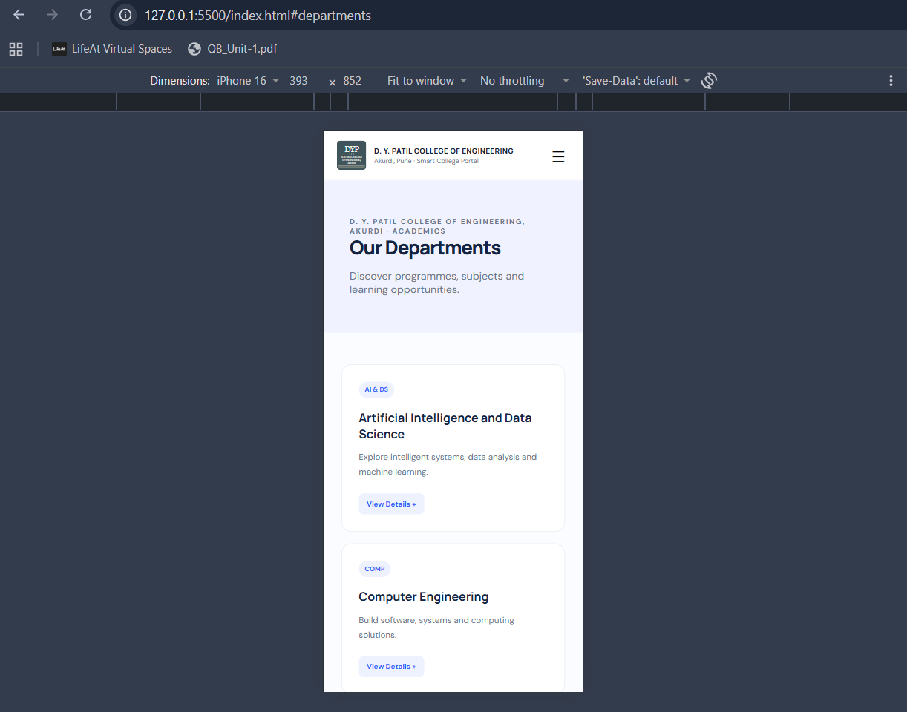

# D. Y. Patil College of Engineering, Akurdi - Smart College Website Portal

**Subject:** Web Technology 1 (AD124PE507.1) | **CCE-5:** Unit V Mini Project
**Name:** _Your Name_ | **Roll No:** _Your Roll No_ | **Batch:** _Your Batch_

## Problem Statement
Students and parents often struggle to find college information such as departments,
courses, faculty details and the college mission and vision in one place. This project is a
simple, responsive front-end portal that shows all this information and also lets visitors
send an enquiry.

**Users:** students, parents and visitors.

## Features
- Single Page Application (SPA): pages change without a full reload
- Client-side routing using `location.hash` (`#/home`, `#/courses`, ...)
- Pages: Home, Mission & Vision, Departments, Courses, Faculty, Enquiry
- Data loaded dynamically from separate JSON files (`departments`, `courses`, `faculty`) using `fetch()`
- Course filter by department and faculty search by name
- Enquiry form with client-side validation (name, email, 10-digit phone, department, message)
- Responsive layout with a mobile menu
- Page components: Header, Navigation, Content area, Footer

## Technologies
HTML5, CSS3, JavaScript (ES6), JSON

## Project Structure
```
index.html   - page layout (header, nav, content area, footer)
style.css    - styling and responsive design
app.js       - routing, data loading, rendering, validation
data/        - departments.json, courses.json, faculty.json
images/      - logo.png
README.md    - documentation
```

## How to Run
1. Download or clone this repository.
2. Open the folder in VS Code (File > Open Folder) and click **Trust** if asked.
3. Install the **Live Server** extension.
4. Right-click `index.html` and choose **Open with Live Server**.

> Opening `index.html` by double-clicking will not work, because browsers block `fetch()` on `file://` pages.

## Screenshots
_Add screenshots here (Home, Mission & Vision, Courses, Faculty, Enquiry form, mobile view)._

## Screenshots

### Home


### Mission & Vision


### Courses


### Faculty


### Enquiry Form (validation)


### Mobile View


## Testing
| Test | Result |
|------|--------|
| All nav links open the correct page without reload | Pass |
| Data loads from the JSON files in data/ | Pass |
| Invalid enquiry form shows error messages | Pass |
| Valid enquiry form shows success message | Pass |
| Layout works on mobile width | Pass |

## Author
_Your Name_ - T.Y. AI&DS, D. Y. Patil College of Engineering, Akurdi, Pune 411044
